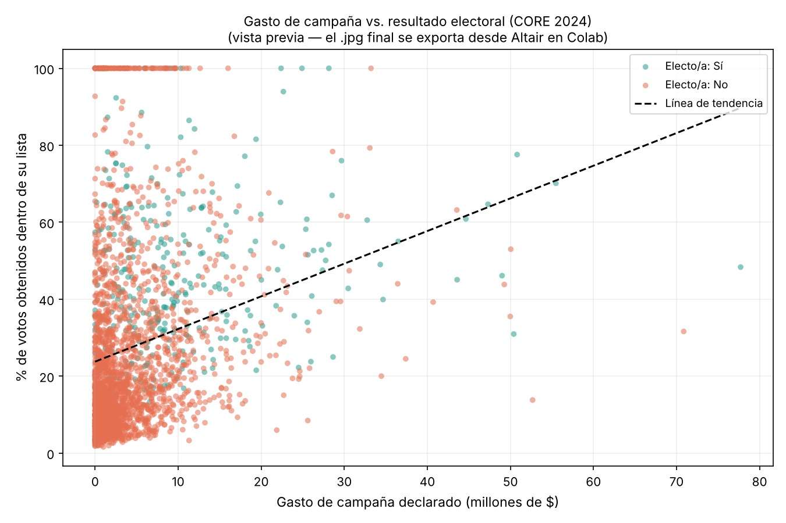

# Gasto de campaña vs. resultado electoral: ¿sirve gastar más?

En la elección de Consejeros Regionales (CORE) 2024 compitieron 2.515 candidaturas en todo Chile. Cada una declaró ante el SERVEL cuánto gastó en su campaña, desde los que no gastaron nada hasta quien llegó a declarar más de 77 millones de pesos. La pregunta que guía esta visualización es simple: ¿a más gasto, mejor resultado?

El gráfico cruza, candidato por candidato, el gasto declarado (en millones de pesos) con el porcentaje de votos que obtuvo dentro de su propia lista. Cada punto es una persona candidata. El color distingue si resultó electa (verde) o no (naranjo), y la línea punteada marca la tendencia general.

La tendencia sube: mientras más gasto declarado, en promedio, más alto es el porcentaje de votos dentro de la lista. Si se ordena a todos los candidatos en diez grupos según cuánto gastaron, el grupo que gastó menos obtuvo en promedio un 21% de los votos de su lista, mientras que el grupo que gastó más llegó a un 40%, casi el doble. La correlación entre ambas variables es de 0,24 (coeficiente de Pearson), estadísticamente significativa, aunque no muy fuerte: es una tendencia real, pero el gasto no explica por sí solo quién gana y quién pierde.

Esto se nota con más fuerza al separar a quienes efectivamente resultaron electos: en promedio gastaron $10,3 millones, más del doble que los $4,2 millones de quienes no lo lograron. Visto en medianas (un número menos sensible a los casos extremos) la diferencia es parecida: $7,5 millones contra $2,3 millones.

Pero la historia no es tan simple como "el que gasta más, gana". De los 302 candidatos que finalmente fueron electos, 8 no declararon ningún gasto de campaña y aun así ganaron su cupo. Y al mismo tiempo, 66 de esos 302 electos están entre el grupo que gastó muy por encima del resto (lo que en la Entrega 02 se identificó como valores atípicos o "outliers" de gasto). Es decir, hay electos de ambos extremos: los que no gastaron nada y los que gastaron muchísimo.

Esto deja una pista importante para seguir investigando: el gasto se relaciona con el resultado, pero de forma más débil de lo que la intuición sugiere, y conviven casos que escapan completamente al patrón general. Dicho de otra forma, el dinero ayuda, pero no es la explicación completa. La otra mitad de la historia —el lugar que cada candidatura ocupa en la lista— es la que muestra la visualización de Amanda: dos de cada tres electos iban primeros en su lista. En conjunto, ambas visualizaciones apuntan a que el resultado de una candidatura a CORE depende de más de un factor actuando al mismo tiempo, no de uno solo.
