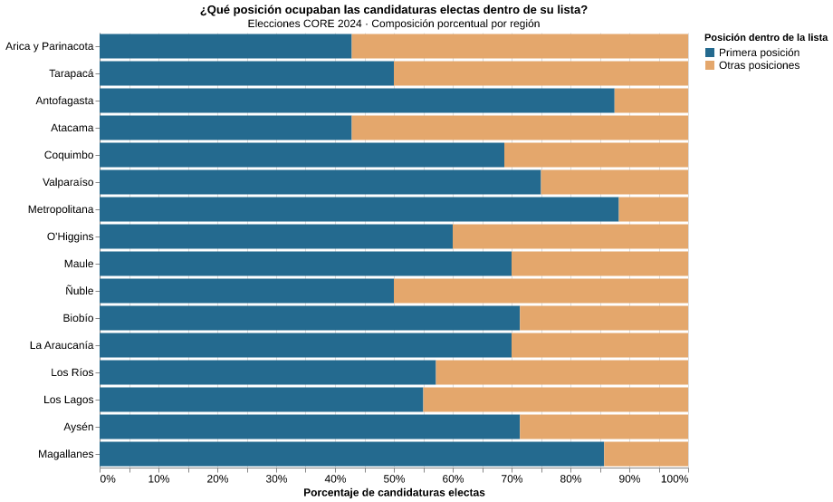

## El primer lugar de la lista no asegura la elección

Antes de marcar una preferencia en la papeleta, los electores se encuentran con una lista de nombres ordenados. Algunos aparecen al comienzo y otros, varias líneas más abajo. Aunque todos compiten en la misma elección, no ocupan el mismo lugar frente a quien debe decidir por cuál votar. ¿Qué tan frecuente es que quienes encabezan sus listas terminen consiguiendo un escaño?

En las elecciones de consejeros regionales (CORE) de 2024, 2.515 candidaturas participaron en las 16 regiones de Chile, según la base de datos utilizada para este análisis. De ellas, 302 resultaron electas. Al revisar la posición que ocupaban dentro de sus respectivas listas, aparece una diferencia marcada: 204 de las candidaturas ganadoras estaban en el primer lugar de su lista, mientras que 98 figuraban en posiciones posteriores.

Esto significa que aproximadamente dos de cada tres personas electas encabezaban su lista. Pero la cifra también muestra que casi una de cada tres consiguió un escaño sin aparecer primero. El orden, por lo tanto, no permite anticipar por sí solo quién llegará al consejo regional.

La distribución cambia al mirar cada región. En la Región Metropolitana, 30 de las 34 candidaturas electas ocupaban la primera posición. En Antofagasta fueron 14 de 16, y en Magallanes, 12 de 14. En las tres regiones, la gran mayoría de quienes consiguieron un escaño encabezaba su lista.

En otros lugares, la diferencia es menor o incluso se invierte. En Arica y Parinacota, seis de las 14 candidaturas electas estaban primeras y ocho aparecían después. En Atacama ocurrió exactamente lo mismo. En Tarapacá, Ñuble y otras regiones, la distribución fue más equilibrada. Los resultados muestran que el peso de las primeras posiciones entre las personas electas no fue igual en todo el país.

El gráfico permite recorrer esas diferencias de norte a sur. Cada barra representa a las candidaturas electas de una región y distingue entre quienes ocupaban el primer lugar de su lista y quienes estaban en otra posición. Los porcentajes corresponden al total de personas electas en cada región, por lo que las barras permiten comparar su composición, aunque los territorios tengan distintos números de escaños.

Sin embargo, hay una distinción importante. Que el 67,5 % de las candidaturas electas haya estado en primer lugar no significa que esa posición explique el resultado. También importa cuántas personas compitieron desde cada lugar. En la base analizada, 702 candidaturas ocupaban la primera posición, mientras que 1.813 se encontraban en posiciones posteriores. Los dos grupos, por tanto, no tenían el mismo tamaño desde el inicio.

Además, una elección no depende únicamente del orden de los nombres. La votación obtenida, la competencia dentro de cada lista y las características de las candidaturas también forman parte del resultado. Este gráfico no permite establecer qué habría ocurrido si las mismas personas hubieran aparecido en otro puesto de la papeleta.

Lo que sí revela es una regularidad y sus excepciones. La mayoría de las personas electas encabezaba su lista, pero 98 llegaron al cargo desde posiciones posteriores. Esa diferencia abre una pregunta para continuar la investigación: ¿cuánto del éxito electoral se relaciona con el lugar que ocupa una candidatura y cuánto con otros factores, como los recursos destinados a su campaña?